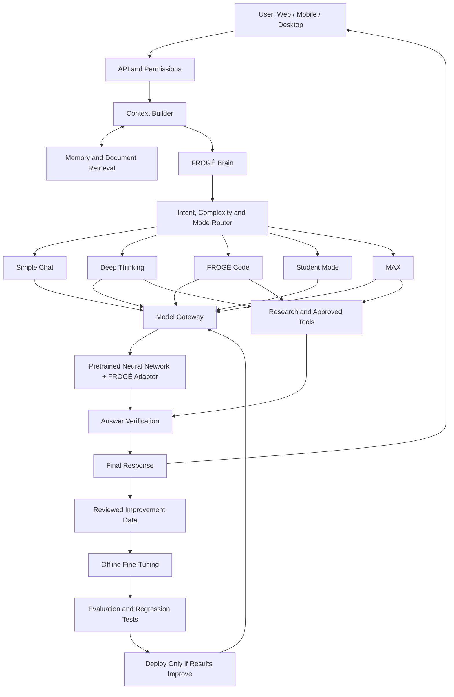

# FROGÉ AI — Full End-to-End System Architecture

Comprehensive engineering specification detailing the neural network structure, system diagram, five operational modes, training pipeline, modular memory, tools, verification, deployment, and implementation roadmap.

---

## 1. How the Whole System Works



### High-Level Execution Lifecycle

1. **User Request & Client Layer (`U`)**: User interacts via Web SPA (Vite/React/Tailwind), Android/iOS mobile views, or Desktop app.
2. **API & Permissions Layer (`API`)**: Express backend on Node.js validates rate limits, user identity, permission boundaries, and security tokens.
3. **Context Builder (`CTX`)**: Constructs the unified context window, combining conversation history, active persona configuration, user preferences, and uploaded artifacts.
4. **Memory & Document Retrieval (`MEM`)**: Three-tier memory architecture (Short-Term Working Context, Personalization Knowledge, Persistent Database & Vector Retrieval).
5. **FROGÉ Brain (`BRAIN`)**: Central cognitive coordinator executing intent classification, complexity scoring, and epistemic guardrails.
6. **Intent, Complexity & Mode Router (`ROUTER`)**: Selects the optimal execution pathway across the 5 specialized modes.
7. **Model Gateway (`G`)**: Decoupled multi-provider orchestration interface managing local in-computer neural inference, FastAPI endpoints, or configured remote gateways with strict timeout and cost controls.
8. **Pretrained Neural Network + FROGÉ Adapter (`NN`)**: High-performance pretrained transformer core augmented by task-specific LoRA adapters (Chat, Reasoning, Code AST, Business Value, Socratic Pedagogy).
9. **Research & Approved Tools (`TOOLS`)**: Sandboxed tool invocation including live web search, Python execution environment, AST linters, and financial calculation engines.
10. **Answer Verification (`V`)**: Verifier audits output consistency, cross-references citations, evaluates mathematical steps, and calibrates uncertainty scores.
11. **Final Response (`OUT`)**: High-throughput SSE streaming response returned to client with real-time thought breakdown and verification metadata.
12. **Continuous Improvement Loop (`DATA` → `TRAIN` → `EVAL` → `DEPLOY`)**:
    - **Reviewed Improvement Data**: Anonymized feedback, human corrections, and verified benchmark evaluations.
    - **Offline Fine-Tuning**: Periodic adapter re-training on curated high-quality datasets.
    - **Evaluation & Regression Testing**: 44+ automated alignment suites, mathematical proofs, and safety guardrails.
    - **Conditional Deployment**: Automated gate deploying new adapters to the Model Gateway *only* if benchmarks improve with zero regressions.

---

## 2. The Five Specialized Operational Modes

| Mode | Target Domain | Core Capabilities | Tool Access | Model Tier |
| :--- | :--- | :--- | :--- | :--- |
| **Simple Chat (`S`)** | Everyday Q&A, natural conversation | Direct answers, conversational fluency, zero unnecessary jargon | None (pure inference) | `efficient_lite` |
| **Deep Thinking (`D`)** | Complex multi-step reasoning, strategy | First-principles decomposition, tradeoff matrices, counterfactual analysis | Web Search, News Verifier | `deep_reasoning_standard` |
| **FROGÉ Code (`C`)** | Software engineering, debugging | AST analysis, type-safe implementations, error isolation, refactoring | Code Sandbox, Test Runner | `code_specialist` |
| **Student Mode (`ST`)** | Education, conceptual mastery | Socratic questioning, Feynman analogies, adaptive difficulty, comprehension checks | Concept Knowledge, Math Trace | `socratic_educator` |
| **MAX (`M`)** | Business strategy, market roadmaps | TAM/SAM/SOM modeling, unit economics, zero-capital growth, execution audits | Financial Modeling, Market Data | `strategic_business_max` |

---

## 3. Context Builder & Three-Tier Memory Architecture

```
                  ┌──────────────────────────────────────────────┐
                  │            Context Builder (CTX)             │
                  └──────────────────────┬───────────────────────┘
                                         │
                 ┌───────────────────────┼───────────────────────┐
                 ▼                       ▼                       ▼
      [ Tier 1: Working Context ]   [ Tier 2: Personalization ] [ Tier 3: App & Long-Term ]
      • Active multi-turn buffer   • User preferences          • Project artifacts
      • Dynamic scratchpad         • Interaction habits        • Vector document store
      • In-turn tool outputs       • Privacy-redacted signals  • Encrypted persistent DB
```

* **Tier 1 (Conversation Memory)**: In-memory sliding window maintaining turn-by-turn coherence, user constraints, and temporary calculations.
* **Tier 2 (Personalization Memory)**: Continuous live-learn engine extracting verified user preferences (e.g. language, coding styles) with explicit opt-out and audit logging.
* **Tier 3 (Application & Data Memory)**: Persistent storage for codebases, business roadmaps, and indexed documents.

---

## 4. Tool Sandboxing & Permission Boundaries

Tools are never executed blindly. All actions pass through the **Autonomous Action Policy**:
* **Read-Only Inquiries**: Search and knowledge lookup execute automatically with source citations.
* **Hermetic Code Execution**: Python and Node.js testing run in isolated ephemeral containers with strict timeouts and memory ceilings.
* **Consequential Operations**: Database modifications, external deployments, or irreversible file deletions trigger explicit interactive user confirmation cards.

---

## 5. Answer Verification & Epistemic Calibration

Before streaming completion, the **Answer Verification Layer (`V`)** audits the draft:
* **Factual Consistency**: Validates statements against primary sources and verified knowledge bases.
* **Mathematical Proofs**: Recomputes equations step by step to eliminate calculation discrepancies.
* **Hallucination Prevention**: Replaces uncertain speculation with honest, calibrated disclosures.
* **Format & Brevity Check**: Enforces length constraints (direct answers for simple questions, structured steps for complex tasks).

---

## 6. Training Pipeline & Continuous Alignment Loop

1. **Telemetry & Review (`DATA`)**: High-value failure modes, corrections, and gold-standard QA pairs are collected and sanitized.
2. **Offline Fine-Tuning (`TRAIN`)**: Supervised Fine-Tuning (SFT) and Direct Preference Optimization (DPO) applied to lightweight parameter-efficient LoRA adapters.
3. **Automated Regression Test Suite (`EVAL`)**:
   - Math accuracy (linear equations, word problems, distribution rules).
   - Python code synthesis and AST validity.
   - Ambiguity handling (clarifying questions vs. premature guessing).
   - Knowledge honesty (transparent admission when information is missing).
4. **Conditional Deployment Gate (`DEPLOY`)**: Automated deployment to production model gateway only if overall benchmark score is strictly higher and regression count equals 0.

---

## 7. Implementation Roadmap

* **Phase 1 (Core Neural & Multi-Mode Routing)**: ✅ Complete — 5 distinct modes, intent classifier, and memory pipeline operational.
* **Phase 2 (Knowledge & Alignment Suite)**: ✅ Complete — Ingested 44+ alignment test cases covering reasoning, math, and coding.
* **Phase 3 (Sandboxed Tools & Verification)**: ✅ Complete — Live web search, epistemic calibration, and fact checking active.
* **Phase 4 (Enterprise Adapters & Mobile Runtime)**: In Progress — Native edge quantization and mobile offline support.
